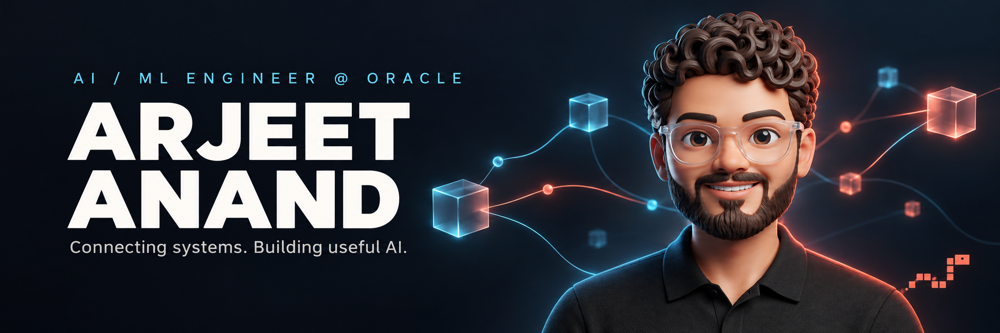

<h1 align="center">
  
</h1>

<strong>Applied AI. Connected systems. A little arcade energy.</strong>

  
  
  
  

  <a href="#the-builder-behind-the-avatar">About</a> &nbsp; / &nbsp;
  <a href="#selected-builds">Projects</a> &nbsp; / &nbsp;
  <a href="#highlights">Highlights</a> &nbsp; / &nbsp;
  <a href="#contribution-arcade">Arcade</a>

## The builder behind the avatar

Hey, I’m **Arjeet** 👋 — an **AI/ML Engineer at Oracle**. I connect applications, data, and models, then turn that foundation into tools people can use. My projects range from voice conversations with documents to prompt evaluation, developer tooling, and 3D city simulations.

> **Keep the source visible. Make the workflow clear. Give people control.**

  

## Selected builds

**Voice AI · LLM evaluation · Spatial simulation · Developer tools**

<table>
  <tr>
    <td width="50%" valign="top">
      01 / VOICE + GROUNDED AI 
      <h3><a href="https://github.com/arjeetanand/PitchVoiceAI">🎙️ Pitchroom AI</a></h3>
      Talk to your decks and documents. Hear an answer, then see the exact slide, page, or section behind it.  
      Python · Whisper · Kokoro · Document retrieval
    </td>
    <td width="50%" valign="top">
      02 / LLM EVALUATION 
      <h3><a href="https://github.com/arjeetanand/PromptMesh">🧪 PromptMesh</a></h3>
      Put prompts through their paces: compare models, inspect scores and latency, generate tests, and improve with feedback.  
      Python · FastAPI · Ollama · OCI GenAI · Cohere
    </td>
  </tr>
  <tr>
    <td width="50%" valign="top">
      03 / SPATIAL SIMULATION 
      <h3><a href="https://github.com/arjeetanand/bengaluru-traffic-digital-twin">🚦 Bengaluru Traffic Digital Twin</a></h3>
      Explore Marathahalli in 3D. Compare traffic interventions using documented OpenStreetMap data and explicitly modelled results.  
      TypeScript · React · Three.js · React Three Fiber
    </td>
    <td width="50%" valign="top">
      04 / MARKET RESEARCH 
      <h3><a href="https://github.com/arjeetanand/backtesting-stockmarket">📈 Backtrack</a></h3>
      Replay the market, test a strategy, and inspect the risk using official NSE historical data. Local research and simulated trades only.  
      Python · FastAPI · Next.js · SQLite
    </td>
  </tr>
  <tr>
    <td width="50%" valign="top">
      05 / DEVELOPER EXPERIENCE 
      <h3><a href="https://github.com/arjeetanand/onboard-repo-copilot">🧭 Onboard Repo Copilot</a></h3>
      Understand a repository through module maps and cited Q&amp;A, with human handoffs when confidence is low.  
      Python · FastAPI · React · SQLite
    </td>
    <td width="50%" valign="top">
      06 / AGENT TOOL SECURITY 
      <h3><a href="https://github.com/arjeetanand/mcp-security-gateway">🛡️ MCP Security Gateway</a></h3>
      Put tool allowlists, role-based access, human approvals, and audit logs between AI agents and MCP tools.  
      Python · FastAPI · MCP
    </td>
  </tr>
</table>

**Also exploring:** [VectorForge](https://github.com/arjeetanand/vectorforge-raster-to-svg) — turn signatures, sketches, logos, and flat artwork into editable SVG paths with a local computer-vision workflow.

<a href="https://github.com/arjeetanand?tab=repositories"><strong>Explore all repositories →</strong></a>

## Highlights

<table>
  <tr>
    <td width="50%" valign="top">
      01 / BUILDER AWARD 
      <strong>Razorpay × Replit Buildathon</strong> 
      Winner · Sprint Saturday · Bengaluru · Sep 2026  
      <a href="https://luma.com/z9i53l4x">Event details ↗</a>
    </td>
    <td width="50%" valign="top">
      02 / ORACLE AI &amp; DATA SCIENCE 
      <strong>Co-author · <a href="https://blogs.oracle.com/ai-and-datascience/mcp-hybrid-rag-in-oracle-26ai">From Vector Index to MCP Tool</a></strong> 
      Building Hybrid RAG in Oracle Autonomous AI Database 26ai.  
      <a href="https://blogs.oracle.com/ai-and-datascience/mcp-hybrid-rag-in-oracle-26ai">Read the article ↗</a> · <a href="https://www.linkedin.com/posts/arjeetanand_from-vector-index-to-mcp-tool-from-vector-activity-7467621510829182976-lHSe">LinkedIn post ↗</a>
    </td>
  </tr>
</table>

## Toolbox

<strong>🧰 Open the toolbox · AI, backend, frontend, data, voice &amp; vision</strong>

| Area | Tools &amp; interests |
| :--- | :--- |
| AI &amp; evaluation | GenAI · RAG · Agents · MCP · Ollama · OCI GenAI |
| Backend &amp; integration | Python · FastAPI · SQL · APIs · Oracle Integration Cloud |
| Frontend &amp; simulation | TypeScript · React · Next.js · Three.js |
| Data &amp; platforms | SQLite · PostgreSQL · Redis · OCI · Autonomous AI Database 26ai |
| Voice &amp; vision | Whisper · Kokoro · OpenCV |

## Contribution arcade

<strong>🕹️ CODE → COMMIT → PLAY → REPEAT</strong>

<strong>Every contribution is another move.</strong> 
My public GitHub activity, remixed into retro arcade animations.

### 🐍 Level 01 · Feed the snake

<picture>
  <source media="(prefers-reduced-motion: reduce)" srcset="assets/arcade/contributions-static.svg" />
  <source media="(prefers-color-scheme: dark)" srcset="assets/arcade/snake-dark.svg" />
  <source media="(prefers-color-scheme: light)" srcset="assets/arcade/snake.svg" />
  
</picture>

<strong>👾 Unlock bonus levels · Pac-Man + Galaga</strong>

### 👻 Level 02 · Chase the commits

<picture>
  <source media="(prefers-reduced-motion: reduce)" srcset="assets/arcade/contributions-static.svg" />
  <source media="(prefers-color-scheme: dark)" srcset="assets/arcade/pacman-dark.svg" />
  <source media="(prefers-color-scheme: light)" srcset="assets/arcade/pacman.svg" />
  
</picture>

### 🚀 Level 03 · Contributions in the crosshairs

<picture>
  <source media="(prefers-reduced-motion: reduce)" srcset="assets/arcade/contributions-static.svg" />
  <source media="(prefers-color-scheme: dark)" srcset="assets/arcade/galaga-dark.svg" />
  <source media="(prefers-color-scheme: light)" srcset="assets/arcade/galaga.svg" />
  
</picture>

Contribution snapshot · 17 October 2026 · Generated with <a href="https://github.com/Platane/snk">snk</a> and <a href="https://github.com/abozanona/pacman-contribution-graph">Arcade Contribution Graph</a>

<strong>⚡ Behind the build · Connected systems in motion</strong>

  

Click the animation to watch the full video ↗

## Background

B.Tech. in Electronics and Communication Engineering · Vellore Institute of Technology · 2020–2024

---

<strong>Let’s connect around useful AI, developer tools, and systems that work together.</strong> 
<a href="https://www.linkedin.com/in/arjeetanand/">Connect on LinkedIn</a> · <a href="https://blogs.oracle.com/authors/arjeetanand/">Read my writing</a> · <a href="https://github.com/arjeetanand?tab=repositories">Explore my work</a>

Project snapshot refreshed · 17 October 2026

