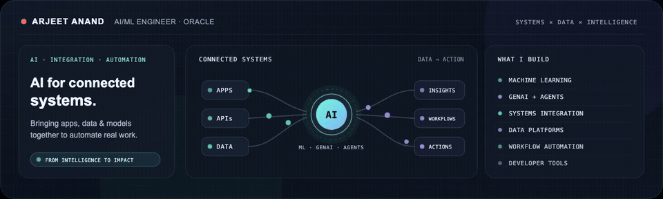

<h1 align="center">Hi, I’m Arjeet Anand 👋</h1>

<strong>AI/ML Engineer @ Oracle · Connecting systems. Building useful AI.</strong>

  

Click the animation to watch the full MP4 ↗

  

  
  
  
  

<strong>AI / ML</strong> · <strong>Systems integration</strong> · <strong>Data platforms</strong> · <strong>Intelligent automation</strong>

## From connected systems to useful AI

I’m an **AI/ML Engineer at Oracle**, building across GenAI, enterprise integration, data engineering, and developer tools. I like turning complex systems into products people can actually use: ask a document a question, compare prompts across models, understand a codebase, or explore a city in 3D.

My approach: **keep the source visible, make the workflow clear, and give people control.**

## On the workbench · October 2026

- **[Pitchroom AI](https://github.com/arjeetanand/PitchVoiceAI)** — voice conversations with decks and documents, with answers linked to the exact slide, page, or section. Latest repository update: **10 October**.
- **[PromptMesh](https://github.com/arjeetanand/PromptMesh)** — compare prompt versions across LLMs, generate test cases, and iterate with evaluation feedback. Latest repository update: **3 October**.
- **[Bengaluru Traffic Digital Twin](https://github.com/arjeetanand/bengaluru-traffic-digital-twin)** — explore the Marathahalli corridor in 3D and compare modelled traffic scenarios. Latest repository update: **19 September**.

## Highlights

<table>
  <tr>
    <td width="50%" valign="top">
      01 / BUILDER AWARD 
      <strong>Razorpay × Replit Buildathon</strong> 
      Winner · Sprint Saturday · Bengaluru · Sep 2026  
      <a href="https://luma.com/z9i53l4x">Event details ↗</a>
    </td>
    <td width="50%" valign="top">
      02 / ORACLE AI &amp; DATA SCIENCE 
      <strong>Co-author · <a href="https://blogs.oracle.com/ai-and-datascience/mcp-hybrid-rag-in-oracle-26ai">From Vector Index to MCP Tool</a></strong> 
      Building Hybrid RAG in Oracle Autonomous AI Database 26ai.  
      <a href="https://blogs.oracle.com/ai-and-datascience/mcp-hybrid-rag-in-oracle-26ai">Read the article ↗</a> · <a href="https://www.linkedin.com/posts/arjeetanand_from-vector-index-to-mcp-tool-from-vector-activity-7467621510829182976-lHSe">LinkedIn post ↗</a>
    </td>
  </tr>
</table>

## Selected builds

<table>
  <tr>
    <td width="50%" valign="top">
      01 / VOICE + GROUNDED AI 
      <h3><a href="https://github.com/arjeetanand/PitchVoiceAI">🎙️ Pitchroom AI</a></h3>
      Turn decks and work documents into a voice room. Ask questions, hear answers, and inspect the supporting slide, page, or section.  
      Python · Whisper · Kokoro · Document retrieval
    </td>
    <td width="50%" valign="top">
      02 / LLM EVALUATION 
      <h3><a href="https://github.com/arjeetanand/PromptMesh">🧪 PromptMesh</a></h3>
      Compare prompt versions across models, inspect scores and latency, generate test cases, and evolve prompts through feedback.  
      Python · FastAPI · Ollama · OCI GenAI · Cohere
    </td>
  </tr>
  <tr>
    <td width="50%" valign="top">
      03 / SPATIAL SIMULATION 
      <h3><a href="https://github.com/arjeetanand/bengaluru-traffic-digital-twin">🚦 Bengaluru Traffic Digital Twin</a></h3>
      A 3D Marathahalli corridor built from documented OpenStreetMap data, with traffic interventions and baseline/scenario comparisons. Results are modelled estimates.  
      TypeScript · React · Three.js · React Three Fiber
    </td>
    <td width="50%" valign="top">
      04 / MARKET RESEARCH 
      <h3><a href="https://github.com/arjeetanand/backtesting-stockmarket">📈 Backtrack</a></h3>
      A local research workspace for official NSE historical data, strategy backtests, candle replay, and risk analysis. Research and simulated trades only.  
      Python · FastAPI · Next.js · SQLite
    </td>
  </tr>
  <tr>
    <td width="50%" valign="top">
      05 / DEVELOPER EXPERIENCE 
      <h3><a href="https://github.com/arjeetanand/onboard-repo-copilot">🧭 Onboard Repo Copilot</a></h3>
      Understand a repository through module maps and cited Q&amp;A, with human handoffs when confidence is low.  
      Python · FastAPI · React · SQLite
    </td>
    <td width="50%" valign="top">
      06 / AGENT TOOL SECURITY 
      <h3><a href="https://github.com/arjeetanand/mcp-security-gateway">🛡️ MCP Security Gateway</a></h3>
      Put tool allowlists, role-based access, human approvals, and audit logs between AI agents and MCP tools.  
      Python · FastAPI · MCP
    </td>
  </tr>
</table>

**Also exploring:** [VectorForge](https://github.com/arjeetanand/vectorforge-raster-to-svg) — turn signatures, sketches, logos, and flat artwork into editable SVG paths with a local computer-vision workflow.

<a href="https://github.com/arjeetanand?tab=repositories"><strong>Explore all repositories →</strong></a>

## Toolbox

| Area | Tools &amp; interests |
| :--- | :--- |
| AI &amp; evaluation | GenAI · RAG · Agents · MCP · Ollama · OCI GenAI |
| Backend &amp; integration | Python · FastAPI · SQL · APIs · Oracle Integration Cloud |
| Frontend &amp; simulation | TypeScript · React · Next.js · Three.js |
| Data &amp; platforms | SQLite · PostgreSQL · Redis · OCI · Autonomous AI Database 26ai |
| Voice &amp; vision | Whisper · Kokoro · OpenCV |

## Background

B.Tech. in Electronics and Communication Engineering · Vellore Institute of Technology · 2020–2024

---

<strong>Let’s connect around useful AI, developer tools, and systems that work together.</strong> 
<a href="https://www.linkedin.com/in/arjeetanand/">Connect on LinkedIn</a> · <a href="https://blogs.oracle.com/authors/arjeetanand/">Read my writing</a> · <a href="https://github.com/arjeetanand?tab=repositories">Explore my work</a>

Project snapshot refreshed · 17 October 2026

